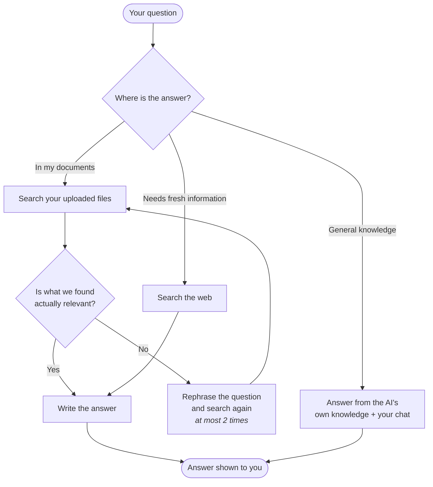

# Adapt-RAG

**A chatbot that knows where to look for the answer.**

You can ask Adapt-RAG three kinds of questions, and it decides on its own where the answer should come from:

| You ask… | It answers from… | Example |
|---|---|---|
| About a file you uploaded | **your document** | "How many vacation days do we get?" (from your HR handbook PDF) |
| Something anyone knows | **its own knowledge** | "Who wrote *Pride and Prejudice*?" |
| Something happening right now | **a live web search** | "Who won the most recent Formula 1 race?" |

It also remembers your conversation, so you can ask follow-ups like *"summarise what we talked about"*. Every user has their own account, and **your documents and chats are private to you**.

---

## Contents

1. [What you can do with it](#what-you-can-do-with-it)
2. [How it works (in plain words)](#how-it-works-in-plain-words)
3. [What you need before starting](#what-you-need-before-starting)
4. [Setup: the easy way (Docker)](#setup-the-easy-way-docker)
5. [Setup: without Docker (for development)](#setup-without-docker-for-development)
6. [Using the app](#using-the-app)
7. [Settings (the `.env` file)](#settings-the-env-file)
8. [Troubleshooting](#troubleshooting)
9. [For developers](#for-developers)
10. [Known limitations](#known-limitations)

---

## What you can do with it

- 📄 **Chat with your own files.** Upload a PDF or text file (up to 20 MB) and ask questions about it.
- 🧠 **Ask general questions.** No document needed for "explain photosynthesis".
- 🌐 **Get up-to-date answers.** It searches the web for news and recent events, and tells you **the date** the information is from.
- 💬 **Have a real conversation.** It remembers your recent messages (the last 20), even after you log out and back in.
- 🔒 **Keep things private.** Each account sees only its own documents and chat history.

---

## How it works (in plain words)

Every question goes through a small decision process:



1. **Decide.** An AI model reads your question (and a quick peek at your documents) and picks one of three paths.
2. **Look it up.** It searches your documents, searches the web, or answers directly.
3. **Double-check.** For documents, it checks that what it found really answers the question. If not, it rewords the question and tries again (at most twice), so it never loops forever.
4. **Answer.** It writes a clear answer using only what it found, and says so when it couldn't find something instead of making it up.

### The building blocks

You don't need to know these to use the app, but here is what's under the hood:

| Piece | What it does | Technology |
|---|---|---|
| Website (what you see) | Login page, file upload, chat window | [Streamlit](https://streamlit.io) |
| Server (the brain) | Handles logins, uploads and questions | [FastAPI](https://fastapi.tiangolo.com) |
| Decision process | The flowchart above | [LangGraph](https://langchain-ai.github.io/langgraph/) |
| AI model | Reads, decides and writes answers | [Groq](https://groq.com) (`openai/gpt-oss-120b` by default) |
| Document search | Stores your files so they can be searched by meaning | [Qdrant](https://qdrant.tech) + a small local model (`all-MiniLM-L6-v2`) |
| Web search | Finds current information | [Tavily](https://tavily.com) |
| Memory | Stores accounts and chat history | [MongoDB](https://www.mongodb.com) |

---

## What you need before starting

1. **Two free API keys** (these let the app use the AI model and web search):
   - **Groq**: sign up at [console.groq.com](https://console.groq.com) → *API Keys* → *Create API Key*. It starts with `gsk_`.
   - **Tavily**: sign up at [app.tavily.com](https://app.tavily.com) and copy your key. It starts with `tvly-`.
2. **Docker Desktop**: [download here](https://www.docker.com/products/docker-desktop/). This is the easiest way to run everything.
3. **This project's code**:
   ```bash
   git clone https://github.com/mrcoffeebean14/Adapt-RAG.git
   cd Adapt-RAG
   ```

> 💡 Only want to run it? Docker is all you need. Python is only required for the "without Docker" setup.

---

## Setup: the easy way (Docker)

This starts **everything** (website, server, document search and database) with one command.

**Step 1: Create your settings file.** Copy the example file:

```bash
# macOS / Linux
cp .env.example .env

# Windows (Command Prompt / PowerShell)
copy .env.example .env
```

**Step 2: Fill in your keys.** Open `.env` in any text editor and set at least these three lines:

```env
GROQ_API_KEY=gsk_your_key_here
TAVILY_API_KEY=tvly-your_key_here
SECRET_KEY=paste_a_long_random_string_here
```

To make a good `SECRET_KEY` (it must be **at least 32 characters**), run:

```bash
python -c "import secrets; print(secrets.token_hex(32))"
```

No Python? Any random mix of 40 or more letters and numbers works too. Just don't reuse a real password.

**Step 3: Start it.**

```bash
docker compose up --build
```

The first start takes a few minutes (it downloads everything it needs). When it's ready, open:

👉 **http://localhost:8501**

To stop it, press `Ctrl + C`. To run it in the background instead, use `docker compose up --build -d`, and `docker compose down` to stop. Your accounts and documents are kept between restarts.

---

## Setup: without Docker (for development)

Use this if you want to change the code and see the results immediately.

**You'll also need:** [Python 3.11 or newer](https://www.python.org/downloads/) and [uv](https://docs.astral.sh/uv/) (`pip install uv`).

**Step 1: Install the Python packages.**

```bash
uv sync
```

**Step 2: Start the two databases.** The easiest way is still Docker:

```bash
docker run -d --name adapt-rag-mongo  -p 27017:27017 -v adapt_rag_mongo:/data/db         mongo:7
docker run -d --name adapt-rag-qdrant -p 6333:6333   -v adapt_rag_qdrant:/qdrant/storage qdrant/qdrant
```

**Step 3: Create `.env`** exactly as in the Docker setup above. The default database addresses (`localhost`) already match step 2.

**Step 4: Start the server and the website**, each in its own terminal:

```bash
# Terminal 1: the server (http://localhost:8000)
uv run uvicorn src.main:app --reload --port 8000

# Terminal 2: the website (http://localhost:8501)
uv run streamlit run streamlit_app/home.py
```

Open **http://localhost:8501**.

---

## Using the app

1. **Create an account.** On the login page, type a username and a password (at least 8 characters), choose **Create Account** and click **Submit**.
2. **Log in.** Switch to **Login** and click **Submit** again.
3. **(Optional) Upload a document.** In the left sidebar:
   - choose a **PDF or TXT** file (max 20 MB),
   - write a short description (e.g. *"Company HR handbook"*),
   - click **Upload** and wait for *"Indexed …"*.
4. **Ask anything** in the chat box at the bottom.

**Good to know**

- Answers about recent events include the date the information is from. If nothing is from today, it tells you so.
- After logging out and back in, the chat window starts empty, **but the assistant still remembers** your earlier conversation. Try *"what did I ask you before?"*.
- Scanned PDFs (photos of pages) can't be read, because they contain no text.

---

## Settings (the `.env` file)

| Setting | Required? | What it is |
|---|---|---|
| `GROQ_API_KEY` | ✅ Yes | Your Groq key (the AI model). |
| `TAVILY_API_KEY` | ✅ Yes | Your Tavily key (web search). |
| `SECRET_KEY` | ⭐ Strongly recommended | A random string, **at least 32 characters**, used to sign logins. If you leave it empty, everyone is logged out whenever the server restarts. |
| `GROQ_MODEL` | Optional | Which Groq model to use. Default: `openai/gpt-oss-120b`. Groq sometimes retires models; if answers stop working, pick a current one from [their model list](https://console.groq.com/docs/models). |
| `MONGODB_URL` | Optional | Where the database is. Default: `mongodb://localhost:27017`. Can also be a free [MongoDB Atlas](https://www.mongodb.com/atlas) cloud database. |
| `MONGODB_DB_NAME` | Optional | Database name. Default: `adaptive_rag`. |
| `QDRANT_URL` | Optional | Where document search runs. Default: `http://localhost:6333`. Can also be a free [Qdrant Cloud](https://cloud.qdrant.io) cluster. |
| `QDRANT_API_KEY` | Only for Qdrant Cloud | Leave empty for a local Qdrant. |
| `QDRANT_DOCS_COLLECTION` | Optional | Name of the document collection. Default: `documents`. |
| `BACKEND_URL` | Optional | Where the website finds the server. Default: `http://127.0.0.1:8000`. |

> ⚠️ **Never share or commit your `.env` file.** It contains your secret keys. It's already listed in `.gitignore`.

---

## Troubleshooting

| What you see | Why | Fix |
|---|---|---|
| `401 Invalid API Key` | The Groq or Tavily key is wrong, or was pasted **with quotes** somewhere that keeps them (e.g. a hosting dashboard). | Re-copy the key and paste it without quotes. |
| `model ... does not exist` | Groq retired the model. | Set `GROQ_MODEL` to a current model from [console.groq.com/docs/models](https://console.groq.com/docs/models). |
| *"Upload failed: could not store document"* | The document search database (Qdrant) isn't running. | Start it (see the setup steps), then try again. |
| `SECRET_KEY must be at least 32 characters` | Your `SECRET_KEY` is too short. | Generate one with the command in the setup section. |
| *"Too many failed logins"* | 5 wrong passwords in a row lock the account for up to 15 minutes. | Wait 15 minutes and try again. |
| *"Backend unreachable"* | The website can't reach the server. | Make sure the server (port 8000) is running. |
| The first answer is slow | On first start, the document-search model is downloaded (~90 MB). | Wait about 30 seconds; it's only once. |

---

## For developers

<details>
<summary><b>Project structure</b></summary>

```
Adapt-RAG/
├── streamlit_app/               The website
│   ├── home.py                  Login / sign-up page
│   ├── pages/chat.py            Upload sidebar + chat window
│   └── utils/api_client.py      Talks to the server
├── src/
│   ├── main.py                  Server entry point (FastAPI)
│   ├── api/routes.py            The server's endpoints
│   ├── api/auth.py              Password hashing and login tokens
│   ├── rag/graph_builder.py     The decision process (LangGraph)
│   ├── rag/retriever_setup.py   Document storage and search (Qdrant)
│   ├── rag/document_upload.py   Reads, splits and stores uploaded files
│   ├── tools/graph_tools.py     Routing rules and the retry limit
│   ├── memory/chat_history_mongo.py   Chat memory (MongoDB)
│   ├── config/prompts.yaml      All instructions given to the AI model
│   └── llms/groq.py             AI model setup
├── docker-compose.yml           Runs everything with one command
├── Dockerfile                   How the app's container is built
└── .env.example                 Template for your settings
```

</details>

<details>
<summary><b>API (use it without the website)</b></summary>

The server documents itself at **http://localhost:8000/docs**, where you can try every endpoint in the browser.

All `/rag/...` endpoints need a login token: `Authorization: Bearer <token>`.

| Endpoint | Send | Get back |
|---|---|---|
| `POST /api/create_user` | `{"username": "...", "password": "..."}` | `200`, or `409` if the name is taken |
| `POST /api/login` | `{"username": "...", "password": "..."}` | `{"token": "..."}`, or `401` |
| `POST /rag/documents/upload` | form data: `file` (PDF/TXT, max 20 MB) and `description` | `{"status": true}` |
| `POST /rag/query` | `{"query": "..."}` | `{"result": {"type": "ai", "content": "..."}}` |

Example with `curl` (macOS/Linux):

```bash
curl -X POST localhost:8000/api/create_user -H 'Content-Type: application/json' \
     -d '{"username":"me","password":"password123"}'

TOKEN=$(curl -s -X POST localhost:8000/api/login -H 'Content-Type: application/json' \
     -d '{"username":"me","password":"password123"}' | python -c "import sys,json; print(json.load(sys.stdin)['token'])")

curl -X POST localhost:8000/rag/documents/upload -H "Authorization: Bearer $TOKEN" \
     -F file=@notes.pdf -F description="My notes"

curl -X POST localhost:8000/rag/query -H "Authorization: Bearer $TOKEN" \
     -H 'Content-Type: application/json' -d '{"query":"Summarise my notes"}'
```

</details>

<details>
<summary><b>Quick self-checks</b></summary>

Two built-in checks run in seconds and need no internet or API keys:

```bash
uv run python -m src.api.auth            # passwords and login tokens
uv run python -m src.tools.graph_tools   # routing and the retry limit
```

Each prints `... ok` when everything is fine.

</details>

<details>
<summary><b>Security, in short</b></summary>

- Passwords are stored as **scrypt hashes**, never as plain text.
- Login tokens are signed with `SECRET_KEY` and **expire after 7 days**.
- **5 failed logins** lock an account for up to 15 minutes, which stops password guessing.
- Every document search is **filtered to the logged-in user**, so nobody can read someone else's files.
- The AI is told to treat text from web pages and documents **as information, not instructions**. This stops simple "ignore your instructions" tricks hidden in a page, but it isn't bulletproof against every attack.

</details>

<details>
<summary><b>Running it on your own server</b></summary>

On any Linux server or VM with Docker installed:

```bash
git clone https://github.com/mrcoffeebean14/Adapt-RAG.git && cd Adapt-RAG
cp .env.example .env        # then fill in your keys
docker compose up --build -d
```

The website is on port **8501** and the API on port **8000**. For a public site, put a web server with HTTPS (e.g. [Caddy](https://caddyserver.com)) in front of port 8501, and use a strong `SECRET_KEY`.

</details>

---

## Known limitations

- **Anyone can sign up**, and every question uses your Groq and Tavily quota. Add rate limiting before sharing it publicly.
- **Logins can't be cancelled early.** A token stays valid for 7 days. Changing `SECRET_KEY` logs everyone out.
- **Account lockout can be abused**: someone who knows your username can lock you out for 15 minutes by typing wrong passwords.
- **Scanned PDFs aren't supported**: there's no text to read in an image.
- **Web answers depend on the search results.** If the newest article isn't found, you get the newest one that was, clearly dated.
